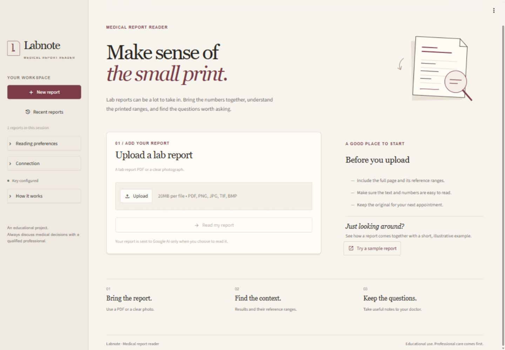

# Labnote

Labnote is a Streamlit medical report reader combined with an optional machine learning pipeline. The app uploads a lab report (PDF or image), extracts the results with Google Gemini, and organizes them into readable tables, explanatory notes, trend comparisons, and downloadable reports. A separate scikit-learn pipeline trains and evaluates models that predict a patient's risk level from structured lab data.



## Features

- **Report reading** — upload a PDF or image and get structured test results, reference notes, and a full Markdown/JSON report.
- **At a glance view** — patient summary, key findings, and highlights for values that deserve attention.
- **Trends** — compare readings across reports for the same named patient when tests and units match.
- **History** — the five most recent readings stay available in the session (up to 20 retained); reopen or start a new report at any time.
- **Sample mode** — *Try a sample report* runs without an API key and clearly marks its values as synthetic demonstration output.
- **ML risk prediction** — an independent training pipeline that preprocesses `data/reports.csv`, compares five classifiers, evaluates the best one, and saves ready-to-use model artifacts.

## Project architecture

Labnote has two independent parts:

| Part | What it does | Needs API key? |
|------|--------------|----------------|
| **App** (`app.py`, `labnote/`) | Gemini-powered report extraction and the Streamlit interface | Yes, for live reading |
| **ML pipeline** (`training/`, `data/`) | Trains classifiers to predict `Risk_Level` from lab values | No |

The two parts share only the repository — the app never loads the trained models, and the training pipeline never calls Gemini. Generated training files under `outputs/` are not required to run the Streamlit app.

## Quick start

Use Python 3.11 or newer. Run all commands below from the repository root.

On Windows, double-click **Start Project.bat**. It creates a local environment, installs missing app dependencies, and starts the server. Keep its terminal open while using the app.

For manual setup on Windows:

```powershell
python -m venv .venv
.\.venv\Scripts\python.exe -m pip install -r requirements.txt
.\.venv\Scripts\python.exe -m streamlit run app.py
```

On macOS or Linux:

```bash
python3 -m venv .venv
.venv/bin/python -m pip install -r requirements.txt
.venv/bin/python -m streamlit run app.py
```

Open [localhost:8501](http://localhost:8501). Stop the server with Ctrl+C in its terminal.

## Configuration

For a fresh clone, copy `.env.example` to `.env` in the repository root and add your own Google AI key:

```dotenv
GEMINI_API_KEY=your_google_ai_studio_api_key
GEMINI_MODEL=gemini-3.5-flash-lite
```

You can also enter your key in the sidebar's **Connection** section for the current browser session. Refresh the browser after changing `.env`.

The configured model must be available to your Google AI account. Live analysis also depends on your network connection and account quota.

## Read a report

1. Upload a PDF or a clear PNG, JPG, JPEG, TIFF, or BMP image.
2. Choose **Read my report**.
3. Explore **At a glance**, **Test results**, **Notes & next steps**, and **Full report**.
4. Save a Markdown report or JSON data from **Full report**.

**Try a sample report** works without an API key and makes no AI request. Its values and risk labels are explicitly marked as synthetic demonstration output.

Under **Reading preferences**, **Include explanations** controls generated notes, **Allow downloads** controls exports, and **Show trends** enables comparisons across reports for the same named patient with matching tests and units. Extracted results remain available if the optional notes request fails.

**Recent reports** shows the five most recent readings and retains up to 20 in the current browser session. You can reopen a reading or choose **New report** to clear the current upload and results while preserving session history.

Uploaded report content is sent to Google AI when you choose **Read my report**. Text PDFs are extracted locally first. Scanned PDFs without selectable text should be uploaded as images.

This is an educational project. Generated output and training results do not establish clinical validity; discuss medical decisions with a qualified healthcare professional.

## Machine learning pipeline

The `training/` folder contains a complete, API-free ML pipeline for predicting a patient's **risk level** (`Low`, `Moderate`, `High`) from routine lab measurements.

### Dataset

`data/reports.csv` holds **500 synthetic patient records** with 14 features:

- **Demographics** — `Age`, `Gender`
- **Blood tests** — `Hemoglobin`, `Glucose_Fasting`, `HbA1c`
- **Lipid panel** — `Cholesterol_Total`, `LDL_Cholesterol`, `HDL_Cholesterol`, `Triglycerides`
- **Other markers** — `Creatinine`, `TSH`, `Vitamin_D`, `Vitamin_B12`
- **Target** — `Risk_Level` (Low: 161, Moderate: 238, High: 101)

The dataset is synthetic and intended for demonstration only. It is separate from the UI's sample report data.

### Step 1 — Preprocessing (`training/preprocess.py`)

- Loads the CSV and writes a **data quality report** (missing values, data types, statistics, duplicates).
- Drops duplicates and identifier columns (`Patient_ID`).
- Detects **IQR outliers** per numeric column and logs them.
- **Imputes** missing values (median for numerics, mode for categoricals).
- **Encodes** `Gender` and other categoricals; label-encodes the target.
- Performs a **stratified 80/20 train-test split** (`random_state=42`).
- Applies **StandardScaler** fit on training data only.
- Saves `train.pkl`, `test.pkl`, and `preproc.pkl` (scaler, column order, encoders) to `outputs/models/`, plus `feature_variance.csv` to `outputs/reports/`.

### Step 2 — Training & comparison (`training/train.py`)

Trains and compares **five classifiers**:

| Model | Notes |
|-------|-------|
| Random Forest | Grid: n_estimators, max_depth, min_samples_split/leaf, max_features |
| Gradient Boosting | Grid: n_estimators, learning_rate, max_depth, subsample |
| Logistic Regression | Grid: C, penalty, solver |
| SVM (RBF/linear) | Grid: C, kernel, gamma; probability estimates enabled |
| K-Nearest Neighbors | Grid: n_neighbors, weights, metric |

For each model the pipeline runs **5-fold cross-validation**, scores on the held-out test set, and writes a `model_comparison.json` report. The model with the best test accuracy is saved as both `best_model.pkl` and `model.pkl`.

Set `TUNE_HYPERPARAMETERS = True` at the bottom of `train.py` to run `GridSearchCV` with `StratifiedKFold` over the full parameter grids (slower, but finds optimal hyperparameters). Set `COMPARE_MODELS = False` to train a single Random Forest instead of the comparison.

### Step 3 — Evaluation & outputs

The best model is evaluated with a full metric suite:

- Accuracy, weighted precision, recall, and F1
- Matthews correlation coefficient and Cohen's kappa
- ROC-AUC (binary or one-vs-rest multi-class)
- Classification report and confusion matrix

Artifacts written under `outputs/` (git-ignored):

```text
outputs/
├── models/       # train.pkl, test.pkl, preproc.pkl, model.pkl, best_model.pkl
├── reports/      # metrics.json, model_comparison.json, confusion_matrix.png,
│                 # feature_importance.png/.csv, class_distribution.png,
│                 # feature_variance.csv, data_quality_report.txt
└── logs/         # preprocessing.log, training.log
```

### Step 4 — Predicting

`training/train.py` exposes helpers you can import after training:

```python
from training.train import predict_single, batch_predict

label, probabilities, confidence = predict_single({
    "Age": 58, "Gender": "Male",
    "Hemoglobin": 13.2, "Glucose_Fasting": 140, "HbA1c": 7.2,
    "Cholesterol_Total": 250, "LDL_Cholesterol": 165,
    "HDL_Cholesterol": 38, "Triglycerides": 180,
    "Creatinine": 1.1, "TSH": 2.7, "Vitamin_D": 20, "Vitamin_B12": 310,
})
# -> ("High", {"High": 0.91, "Low": 0.0, "Moderate": 0.09}, 0.91)
```

On the bundled dataset the pipeline typically reaches ~96% test accuracy with Random Forest or Gradient Boosting, while linear models and KNN score noticeably lower — a useful comparison of model families on the same features.

`predict_single` reloads the saved scaler and encoders, so inputs can be passed as raw values. `batch_predict` accepts a DataFrame and returns per-row predictions with confidence and class probabilities.

### Run the full pipeline

```powershell
.\.venv\Scripts\python.exe -m pip install -r requirements-training.txt
.\.venv\Scripts\python.exe training/preprocess.py
.\.venv\Scripts\python.exe training/train.py
```

On macOS or Linux, use `.venv/bin/python` instead. Run `preprocess.py` first — `train.py` loads the pickles it produces. Training logs stream to the console and to `outputs/logs/`.

## Project structure

```text
.
├── app.py                       # Streamlit entry point
├── labnote/                     # Application package
│   ├── config.py                # Project paths and configuration
│   ├── scanner.py               # Extraction, Gemini analysis, and report generation
│   ├── ui.py                    # Streamlit presentation and session workflow
│   ├── sample_data.py           # Synthetic UI demonstration data
│   └── assets/style.css         # Interface styles
├── tests/                       # API-free regression and UI checks
├── training/                    # ML training pipeline
│   ├── preprocess.py            # Data cleaning, encoding, scaling, split
│   └── train.py                 # Model comparison, evaluation, prediction
├── data/reports.csv             # 500-record synthetic dataset for training
├── scripts/                     # Windows startup and runtime helpers
├── docs/screenshots/            # Interface previews
├── .streamlit/config.toml       # Theme and local server settings
├── .env.example                 # Shareable configuration template
├── requirements.txt             # App dependencies
├── requirements-training.txt    # App + training dependencies
└── Start Project.bat            # Windows launcher
```

`app.py` starts the app directly from the repository root; no editable package installation is required.

## Tests

After installing the app dependencies:

```powershell
.\.venv\Scripts\python.exe -m unittest discover -s tests -v
```

On macOS or Linux, use `.venv/bin/python` instead. The suite covers report extraction, malformed API responses, error handling, sample results, exports, history, and UI state. Configuration and AI clients are mocked; these checks do not use your credentials or send medical data to an API.

## Disclaimer

Labnote is an educational project. The Gemini-generated notes, the synthetic dataset, and the trained models' predictions do not establish clinical validity and must not be used for medical decisions. Always consult a qualified healthcare professional.
